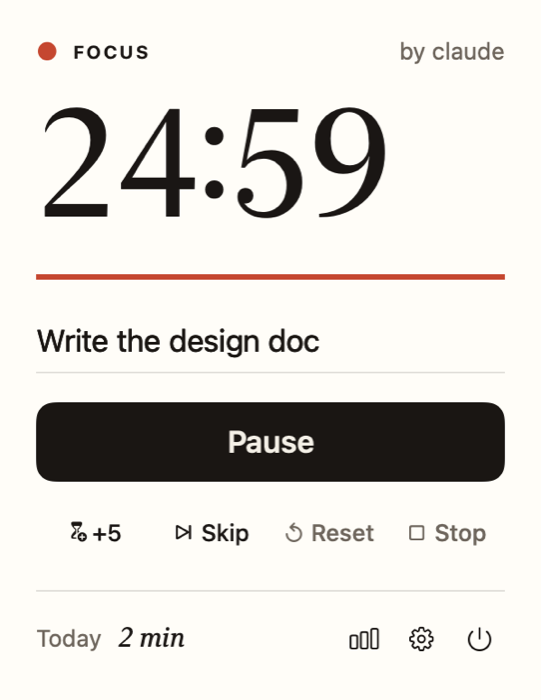
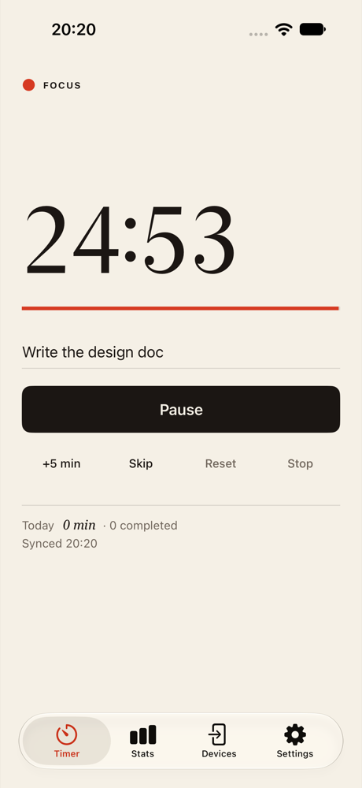
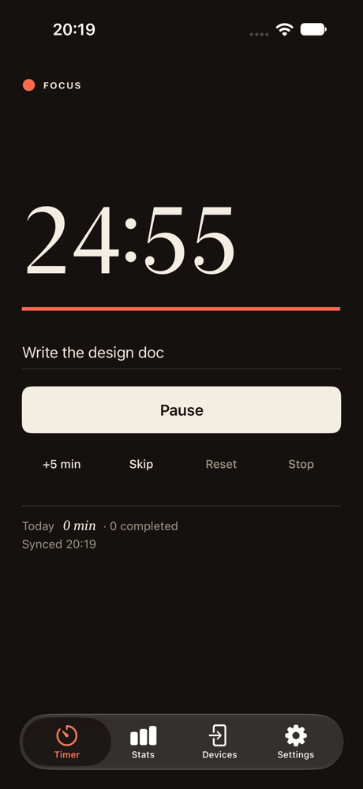
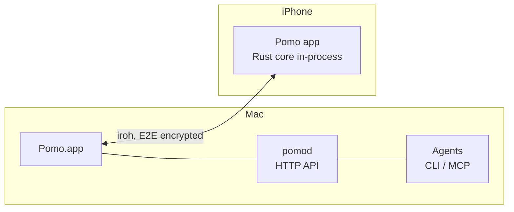
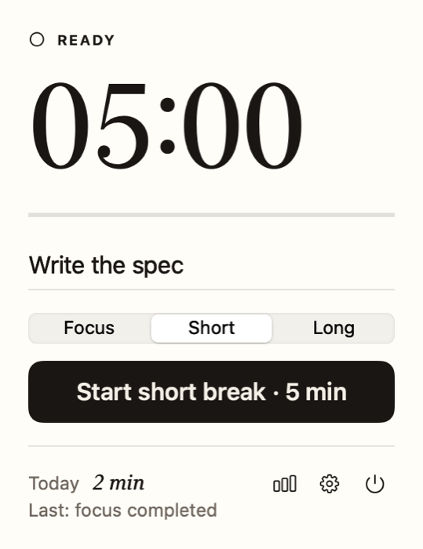
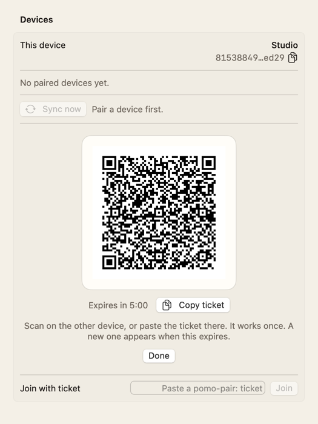
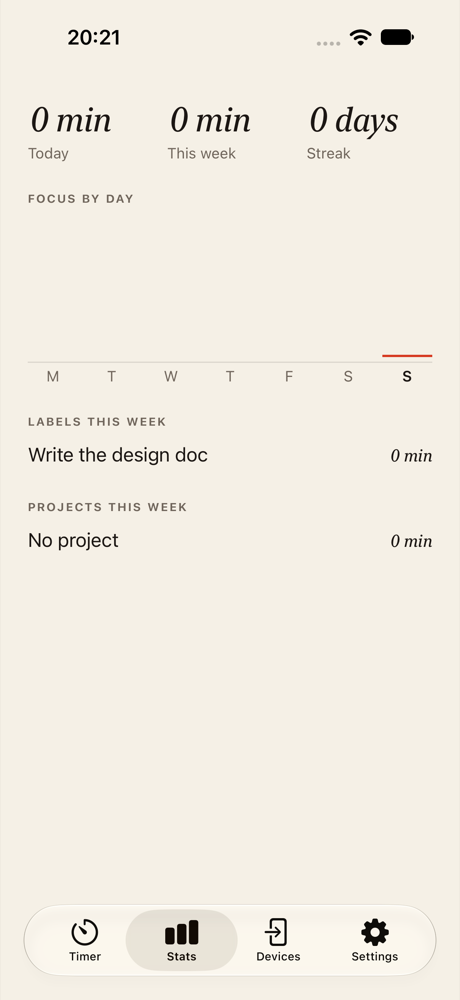
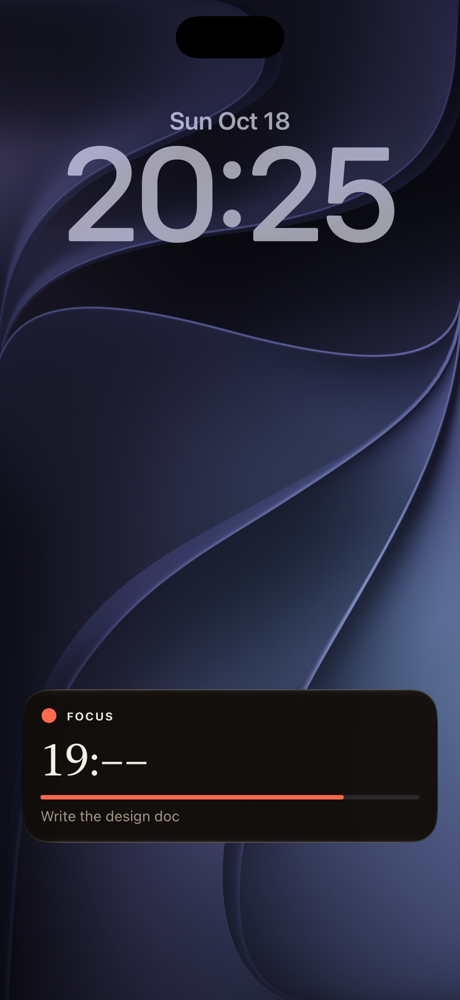

<h1 align="center">Pomo</h1>

<p align="center">
  A local-only Pomodoro timer for people who also work with AI agents.<br>
  Native on Mac and iPhone, synced peer to peer, scriptable by agents. No account, no cloud.
</p>

<p align="center">
  <a href="LICENSE-MIT"></a>
  
  
</p>

<p align="center">
  
  &nbsp;&nbsp;
  
  &nbsp;&nbsp;
  
</p>

## Why

Most timers keep your time on someone else's server and cannot be driven by your tools. Pomo keeps one live timer and one history across your own devices, stores everything in a SQLite file you own, and gives your AI assistant the same controls you have: it can start a block, pause it, and tell you where the week went.

- **Local only.** No account, no hosted backend, no analytics. Devices talk directly to each other over [iroh](https://iroh.computer) (end-to-end encrypted). Relays are used only to connect; you can self-host one.
- **Native shells.** A SwiftUI menu bar app on the Mac and a SwiftUI app on iPhone with a Live Activity and widget. The shared logic is a Rust core, not a UI runtime.
- **Agent friendly.** A localhost HTTP API, a `pomo` CLI with `--json`, and an MCP server over stdio. Every command is idempotent and every block records who started it.
- **Correct by construction.** The timer is an event log folded by a pure function; remaining time comes from absolute timestamps, so devices never drift and a block that ends while an app is closed is still recorded correctly. A shared set of [test vectors](spec/vectors) defines the behaviour for any port.

## Status

Early. The Rust core, sync, daemon, CLI and MCP server are tested and have been through two independent reviews. The Mac and iPhone apps run, and the iPhone app is exercised end to end in the simulator by an XCUITest suite. Not yet done: App Store and notarised builds, Android, Windows, Linux and web, App Intents, and testing on real phones. See [docs/roadmap.md](docs/roadmap.md).

| Part | State |
| --- | --- |
| Rust core, sync, daemon, CLI, MCP | working, 100+ tests |
| Mac menu bar app | working, unsigned build |
| iPhone app, Live Activity, widget | working in the simulator, not tested on a device |
| Other platforms | not started |

## Quick start (Mac)

Requirements: macOS 14+, Rust (stable), Xcode (Swift 6 toolchain).

```sh
git clone https://github.com/hmrdkn-labs/pomo
cd pomo
apple/PomoMac/scripts/bundle.sh        # builds the daemon, CLI and Pomo.app
cp -R apple/PomoMac/.build/bundle/Pomo.app /Applications/
open /Applications/Pomo.app
```

Pomo appears in the menu bar and starts its daemon automatically. On a crowded menu bar it may sit behind the overflow chevron. Data lives in `~/.pomo` (override with `POMO_HOME`).

Or use only the daemon and CLI:

```sh
cargo build --release -p pomod -p pomo-cli
target/release/pomod &                                  # agent API on 127.0.0.1:47831
target/release/pomo start --minutes 25 --label "write the spec"
target/release/pomo status
target/release/pomo stats --since 7d --by label
```

## Use it from an agent

All three interfaces call the same daemon and return the same data.

**CLI.** Add `--json` for exactly the API response, and `--source agent:<name>` to tag who acted.

```sh
pomo start --minutes 50 --label "refactor sync" --source agent:assistant --json
pomo stats --since 7d --by label --json
pomo events --follow          # stream events, including block_end
```

**MCP.** Register `pomo mcp` as a stdio server in any MCP client:

```json
{ "mcpServers": { "pomo": { "command": "pomo", "args": ["mcp"] } } }
```

Tools: `start_focus`, `start_break`, `pause`, `resume`, `stop`, `skip`, `extend`, `reset`, `label_block`, `get_status`, `list_blocks`, `get_stats`, `get_devices`.

**HTTP.** The daemon listens on `127.0.0.1` only and requires a bearer token (`~/.pomo/token`, mode 600). See [spec/api.md](spec/api.md).

## Sync your devices

Devices are peers; none is a server. Pair once, then they converge whenever they can reach each other.

```sh
pomo pair offer            # on the first device: prints a QR code and a one-time ticket
pomo pair join <ticket>    # on the second device
pomo devices               # list paired devices
pomo revoke <device_id>    # stop trusting one
```

On iPhone, use the Devices tab: scan the QR code from the Mac, or paste the ticket. Tickets are single use and expire in five minutes. The protocol is described in [spec/sync.md](spec/sync.md), including its trust model: **paired devices are fully trusted**, so only pair devices you own.

## How it works



- `core/`: events, the timer reducer, the SQLite store, statistics.
- `sync/`: peer-to-peer exchange over iroh.
- `daemon/`, `cli/`: `pomod`, `pomo`, and the MCP server.
- `ffi/`: the core and sync node behind UniFFI, for the Apple apps.
- `apple/`: SwiftUI apps and shared packages (`PomoUI`, `PomoKit`).
- `spec/`: the contract: [events and timer rules](spec/events.md), [sync protocol](spec/sync.md), [agent API](spec/api.md), [SQL schema](spec/schema.sql), [test vectors](spec/vectors), [design tokens](spec/tokens.json).

Design decisions are recorded in [docs/adr](docs/adr). The glossary is in [CONTEXT.md](CONTEXT.md).

## Build and test

```sh
cargo test --workspace                       # Rust: core, sync, daemon, CLI, FFI
cargo clippy --workspace --all-targets -- -D warnings
(cd apple/shared  && swift test)             # design system and view models
(cd apple/PomoKit && swift test)             # needs apple/PomoKit/scripts/build-xcframework.sh first
(cd apple/PomoMac && swift test)
```

iPhone build, simulator tests and device install: [apple/PomoiOS/README.md](apple/PomoiOS/README.md).

## Design

"Paper and ink": warm paper, near-black ink, a serif countdown, and one vermilion accent that appears only while a focus block runs. The rules and tokens are in [docs/ui-reference.md](docs/ui-reference.md).

<p>
  
  &nbsp;
  
  &nbsp;
  
  &nbsp;
  
</p>

## Contributing and security

See [CONTRIBUTING.md](CONTRIBUTING.md) and [SECURITY.md](SECURITY.md). Report vulnerabilities privately, not in public issues.

## License

Licensed under either of [Apache License 2.0](LICENSE-APACHE) or [MIT license](LICENSE-MIT) at your option. Unless you state otherwise, any contribution you submit is dual licensed as above, without additional terms.
