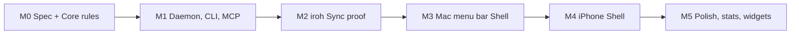

# Roadmap: what we make first

Order is chosen to retire the riskiest unknowns early and to be useful to my Agents from the first Mac milestone.



## M0: Spec and Core rules

Deliver:
- `spec/schema.sql` and numbered migrations (events table, device table, Projection tables).
- `spec/events.md`: event types and payloads, including the hybrid logical clock rules.
- `spec/vectors/*.json`: event sequences with the expected Timer and block state.
- `core/` (Rust): the pure reducer, SQLite store (rusqlite), and a Projection builder.

Done when: the vectors pass in `cargo test`, and rebuilding Projections from the event log gives identical state.

## M1: Daemon, CLI, MCP

Deliver:
- `pomod`: loads the store, serves the localhost HTTP API with a token, applies Commands idempotently, and emits an event stream.
- `pomo` CLI: `start`, `pause`, `resume`, `stop`, `status --json`, `stats --since --by`.
- `pomo mcp`: MCP over stdio, calling the Daemon.

Done when: an Agent can start a 25-minute block, read the status, and ask for a week's focus time grouped by label, with no UI present.

## M2: iroh Sync proof

Deliver:
- The `pomo/sync/1` protocol over an iroh connection: exchange per-device sequence vectors, stream missing events.
- Pairing by ticket, with a confirmation code.
- A test with two Daemons on one machine that diverge offline, reconnect, and converge. A second test over a real relay.

Done when: both tests pass, and the vectors include sync scenarios (two logs in, one merged state out).

This is the hardest part, so it comes before any UI work.

## M3: Mac menu bar Shell

Deliver: SwiftUI `MenuBarExtra` with the live countdown, the popover, settings, open at login, Dock icon hidden. It talks to the Core through UniFFI, or through the Daemon, whichever the M1 and M2 work shows to be simpler.

Done when: a timer started from the CLI or an Agent appears in the menu bar within a second, and vice versa.

## M4: iPhone Shell

Deliver: SwiftUI app, local notification and Live Activity scheduled from the block end time, Pairing by QR, and Sync on open.

Done when: a block started on the Mac shows on the iPhone after Sync, and the iPhone alerts at the end with the app closed.

## M5: Polish

Stats views, widgets, App Intents, global shortcuts, export, Agent token scopes, device revocation.

## Later

Android, Windows, Linux Shells; web (a read-only Daemon view or a WASM Core); an optional always-on peer; an Apple Watch app.

## Repo layout

```
pomo/
  CONTEXT.md
  docs/            requirements, UI reference, roadmap, ADRs
  spec/            schema, events, sync protocol, vectors, tokens
  core/            Rust library (rules, store, sync)
  daemon/          pomod
  cli/             pomo, pomo mcp
  apple/           Mac and iPhone Shells (Xcode project, Swift package for UniFFI bindings)
```
